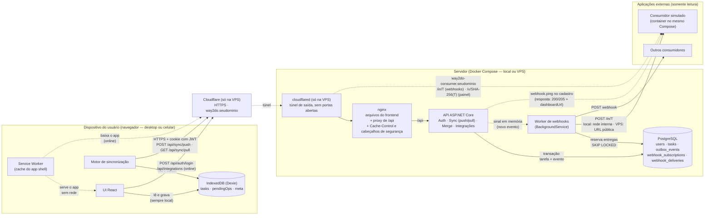
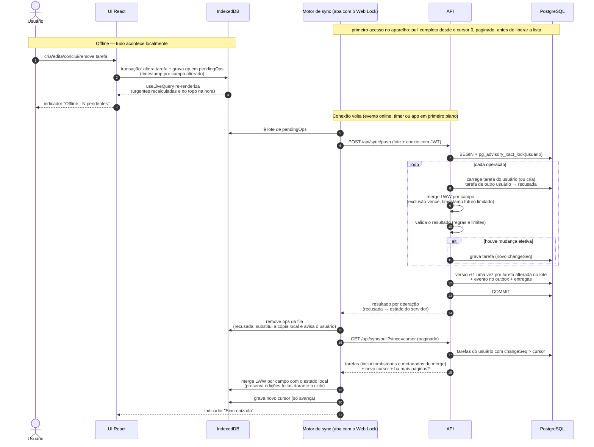
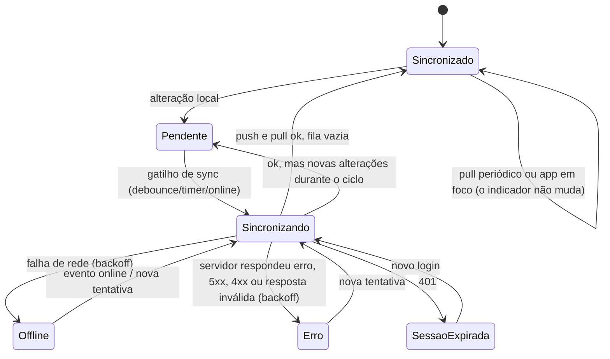
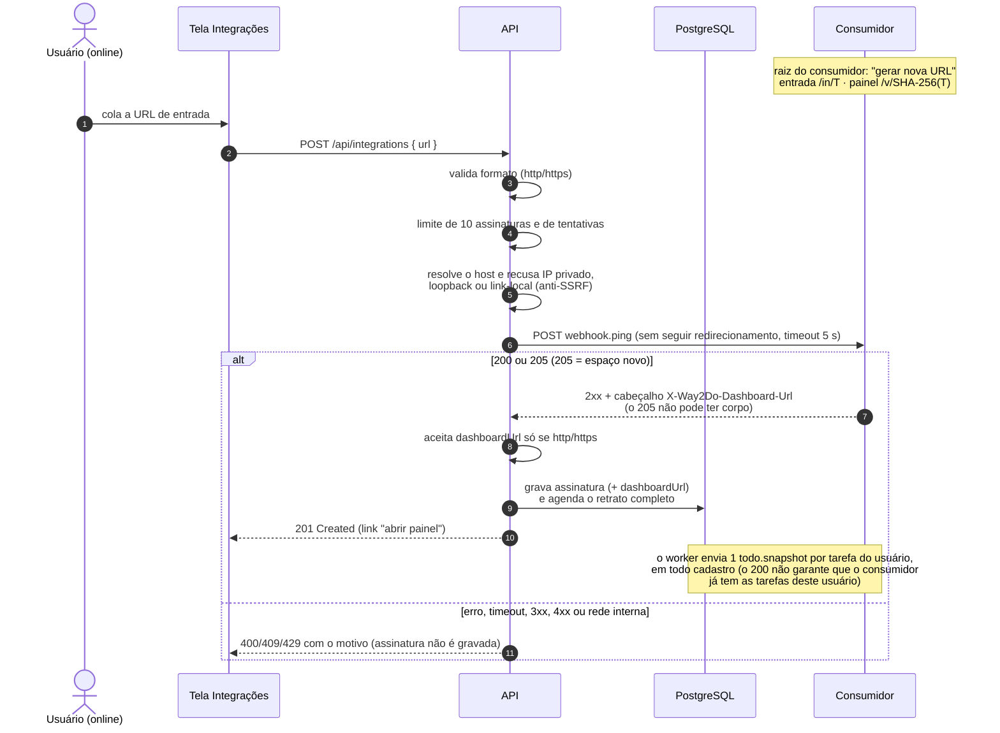
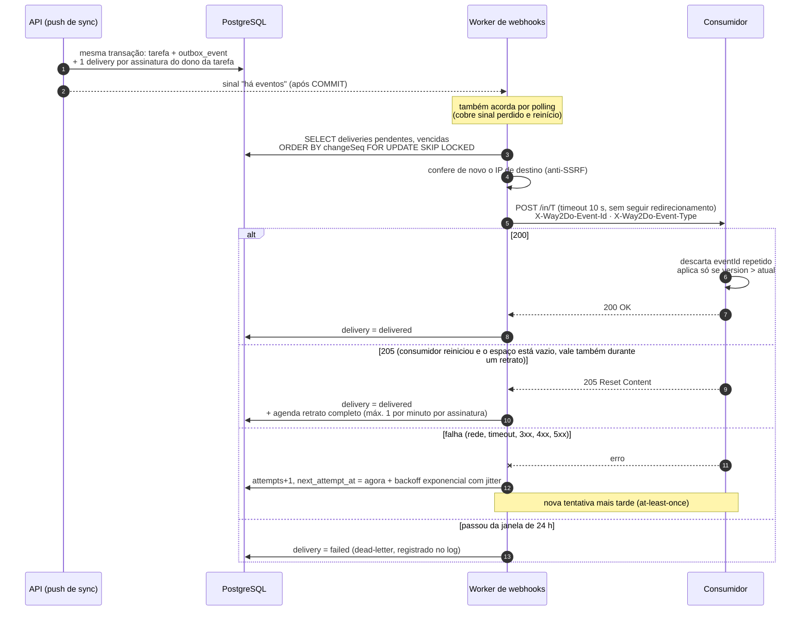

# Arquitetura — Way2Do

Diagramas em Mermaid (renderizados pelo GitHub). As decisões e justificativas estão em [escopo.md](escopo.md); a
execução etapa por etapa, em [plano-de-execucao.md](plano-de-execucao.md).

---

## 1. Visão geral

Quais são os componentes, onde cada um roda e como se comunicam.

| Componente | Onde roda | Comunica com |
|---|---|---|
| UI React + Service Worker | navegador | IndexedDB (local); API só para login, Integrações (online) e via motor de sync |
| IndexedDB (Dexie) | navegador, um banco por usuário | — |
| Motor de sincronização | navegador, uma aba por vez (Web Locks) | API (push/pull) quando há conexão |
| Cloudflare | borda da Cloudflare, **só na VPS** | recebe HTTPS e entrega pelo túnel |
| cloudflared | container, **só na VPS** | conexão de saída até a Cloudflare; repassa para o nginx e para a página do consumidor |
| nginx | container | serve o frontend com `Cache-Control` por tipo de arquivo e cabeçalhos de segurança (CSP); encaminha `/api` para a API (mesma origem, sem CORS) |
| API ASP.NET Core | container (ou `dotnet run` em dev) | PostgreSQL; consumidor, só no `webhook.ping` do cadastro de uma integração |
| Worker de webhooks | mesmo processo da API | PostgreSQL; consumidores via HTTP, nas URLs cadastradas por cada usuário |
| PostgreSQL | container | — |
| Consumidor simulado | container separado | recebe eventos em `/in/<T>`; painel somente leitura em `/v/<SHA-256(T)>`; um espaço isolado por token |

No ambiente local não há Cloudflare nem `cloudflared`: o navegador acessa o nginx direto em `localhost:5300`.

---

## 2. Fluxo da sincronização offline

Da gravação local no dispositivo até a reconciliação no servidor.

### Estados do indicador de sincronização

---

## 3. Fluxo da integração externa

Do servidor até os consumidores: assinaturas por usuário, outbox transacional e webhooks com retry. Detalhes e
justificativas na seção 6 do [escopo](escopo.md).

### Contrato de resposta do consumidor

| Resposta | Significado para o Way2Do |
|---|---|
| 2xx | entregue |
| **205 Reset Content** | entregue **e** "mande o retrato completo" (consumidor novo ou que perdeu o estado) |
| 3xx (redirecionamento não é seguido), 4xx, 5xx, timeout, erro de rede | não entregue → nova tentativa com backoff, por até 24 h |

### Cadastro de uma assinatura

### Entrega das alterações

### Garantias em resumo

| Garantia | Como |
|---|---|
| Nada se perde | evento gravado na mesma transação da alteração (outbox) |
| Só após reconciliar | o evento nasce no servidor, no push, e só se o merge mudou algo |
| Só o backend envia | o dispositivo nunca fala com os consumidores |
| At-least-once | reentrega até 2xx, com backoff exponencial por até 24 h, depois dead-letter |
| Idempotência | `eventId` único; o consumidor deduplica |
| Ordem | evento carrega estado completo + `version`; o consumidor ignora versão antiga (vale também para o retrato completo) |
| Recuperação do consumidor | 205 → retrato completo, assíncrono e limitado a 1 por minuto por assinatura |
| Somente leitura | o consumidor só responde às entregas; não altera dados nem chama o Way2Do |
| Falha de um consumidor | entregas independentes por assinatura |
| Mais de uma instância | `FOR UPDATE SKIP LOCKED` evita entrega dupla concorrente |
| Autenticidade | token secreto na URL de entrada; HMAC do corpo fica como evolução |
| SSRF | IPs privados recusados no cadastro e conferidos de novo a cada entrega (liberados só no ambiente local); redirecionamentos não seguidos |
| Abuso do cadastro | até 10 assinaturas por usuário e limite de tentativas |
| XSS no link do painel | `dashboardUrl` aceito só com `http`/`https` |
| XSS no painel do consumidor | conteúdo inserido só via `textContent` + CSP restritiva |
